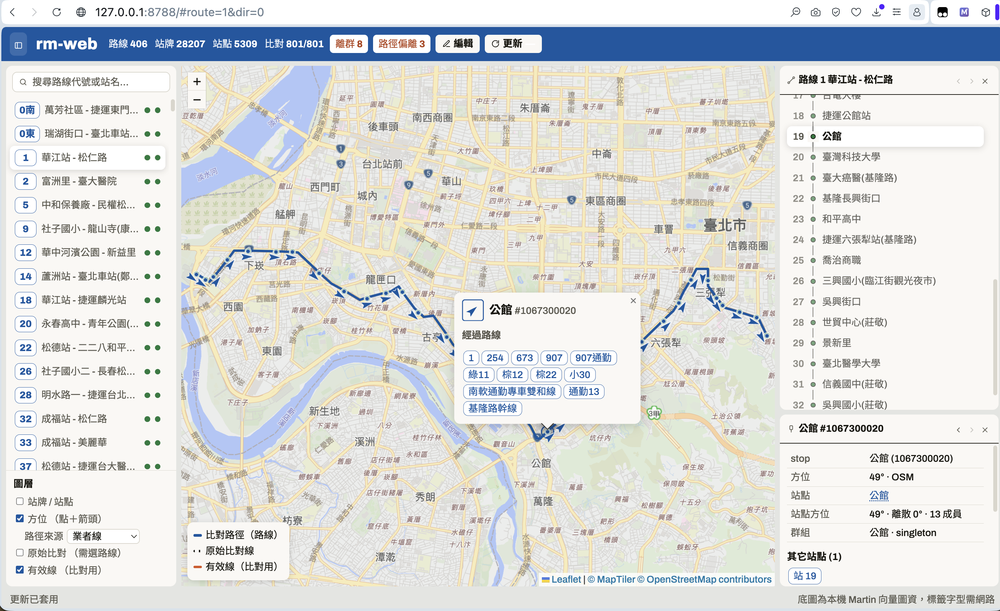

# route_manger — Taiwan bus pipeline

route_manger is an all-Rust pipeline. It turns raw city ebus captures
(Taichung 392, Taipei 406, Tainan 113 routes) into one versioned SQLite
database per city. Each database contains OSM-aligned route geometry and
station bearings. The pipeline implements `docs/Architecture_design_spec.md`
and `docs/DB_Schema_Spec.md`.

## The two problems

A bus route changes in two dimensions. The pipeline is built around them.

**Time.** What did route 1 look like last month? How does the current
version differ? The pipeline keeps the raw captures immutable (the `src_*`
tables), tags each import with a batch, and publishes versions. Stable IDs
from `rm-identity` survive renames and moves across captures. Today this
gives traceability on write. Time-travel queries across versions (re-import
diffing, V2+ transitions) are future work — see Known limits.

**Space.** A route is more than a graph of stops and lines. The system
records the topological correspondence between each route and the base map:
`seg_match_way` says which OSM ways each path segment *is*,
`path_stop_projection` places each stop on the network by chainage, and the
bearings give the direction of travel. The alignment is topological, not
just geometric — the pipeline knows the road, not only a similar shape.

## The pipeline

The data flow has seven steps. It solves the two problems in order:

1. **Capture** — a crawler records the raw JSON captures.
2. **Ingest** — `rm-ingest` imports the JSON into SQLite. The `src_*` tables
   hold the raw facts. Do not change these tables.
3. **Identity** — `rm-identity` gives stable IDs to routes, stops, and
   stations.
4. **OSM match** — `rm-osm-match` aligns the raw path polylines to the OSM
   road network with the Viterbi algorithm (all 812 Taipei directions run in
   about 11 minutes). It writes `seg_match_way`: the OSM ways that each path
   segment uses.
5. **Segments** — `rm-segments` calculates the chainage of each stop on the
   path.
6. **Registry** — `rm-registry` calculates the stop and station bearings.
7. **Publish** — `rm-publish` publishes the version. The `rm-web` tool then
   shows the map and edits the data.

## Layout

```
crates/
├── rm-core         domain types, polyline codec, geo, blake3 helpers
├── rm-db           migrations, id allocator, import_batch
├── rm-ingest       raw JSON -> src_* staging tables
├── rm-identity     staging -> identities + Stop/Station/StationGroup V1
├── rm-publish      Route/SubRoute/RouteStop V1 atomic publish
├── rm-segments     polyline decode, stop projection (chainage), geometry cuts
├── rm-osm-prepare  PBF -> road graph tables
├── rm-osm-match    Viterbi way-run matcher (Newson-Krumm + A* gap repair)
├── rm-registry     stop/station bearings + dual-carriageway station split
├── rm-edit         manual-edit domain services (no SQL; rm-db persists)
├── rm-verify       invariant checks, count cross-checks, QA exports
└── rm-web          map-centric web UI (read-only; add --edit for edits)
```

## Run

```sh
# 0. one-time: place captures under assets/Taichung/raw/ and a Taiwan-wide
#    OSM extract under assets/ (e.g. taiwan-261004.osm.pbf; untracked, see
#    .gitignore), then pass it via --pbf to rm-osm-prepare, with
#    --clip "south,west,north,east" (route bbox + ~10 km) to keep the DB
#    compact — clipped matching is bit-for-bit identical to unclipped

# 1. build
cargo build --release

# 2. pipeline (each step idempotent per batch; each prints a summary line)
cargo run -r -p rm-ingest        # raw -> staging, opens batch 1
cargo run -r -p rm-identity      # identities + V1 versions
cargo run -r -p rm-publish       # 392 routes, atomic per route
cargo run -r -p rm-segments      # projections + geometry drafts
cargo run -r -p rm-osm-prepare \ # PBF -> osm_* tables
    -- --pbf assets/taiwan-261004.osm.pbf --clip "23.89,120.41,24.53,121.42"
cargo run -r -p rm-osm-match     # way runs + match stats
cargo run -r -p rm-registry      # stop_bearing / station_bearing +
                                  #   dual-carriageway station split

# Post-edit refresh (after web edits — see docs/web-edit-mode.md; marks
# accumulate across edits, one pass processes all)
cargo run -r -p rm-osm-match -- --stale # re-match line overrides marked stale
cargo run -r -p rm-segments -- --stale  # reproject routes marked stale by web edits
cargo run -r -p rm-registry -- --stale  # rebuild bearings + split for marked-stale, clear marks
# In the web UI (edit mode) the same chain is one button: ⟳ apply updates

# 3. verify + QA exports (exits non-zero on any failed check)
cargo run -r -p rm-verify -- --preset taichung   # | taipei | tainan
```

All bins accept these flags:

- `--db` — the database path. Default: `data/taichung.db`.
- `--batch` — the batch to process. Default: the latest batch of any status.
  `rm-identity` uses the latest OPEN batch.

`rm-verify` writes these QA files:

- `qa/report.json`
- `qa/outlier_stops.csv`
- `qa/bearing_report.json`
- `qa/match_dev_report.json`
- `qa/pair_spread_report.json`
- `qa/grouping_report.json`

## Bearings

`stop_bearing` is the departure heading (degrees from north) of the bus at
each stop. The pipeline takes it from the matched OSM way run when one way
covers the stop. Otherwise it uses the route polyline tangent. The final
stop of a direction reports its arrival heading.

`station_bearing` is the mean travel **axis** of a station's member stops.
Headings 180° apart fold onto one axis — one pole legitimately serves both
directions of a road. `max_spread_deg` is the largest deviation from that
axis. The pipeline flags a station when its members sit more than 45° off
its axis. This flag is warn-only (`report.json` warnings +
`qa/bearing_report.json`). It never fails the run.

To browse the result, use the web UI. It is read-only unless you pass
`--edit` (see `docs/web-edit-mode.md`). Without `--edit`, it is safe to run
it next to the pipeline:

```sh
cargo run -r -p rm-web -- --db data/taichung.db --addr 127.0.0.1:8787
```

The basemap is vector tiles rendered in-browser by vendored MapLibre GL
(5.24.0 UMD, worker inlined — v6 is ESM-only and would break the
single-binary `include_str!` build) behind the `leaflet-maplibre-gl`
adapter (0.1.4). By default it reads the OpenMapTiles Taipei extract from
a local [Martin](https://maplibre.org/martin/) server at
`http://localhost:3000` (`--tiles <url-template>` overrides the source).
Two online remnants, mirroring the Google Fonts exception: label glyph
fonts and the sprite come from CDNs referenced by the osm-liberty style,
so the basemap draws offline but labels need the network. The adapter
only mirrors Leaflet's viewport into GL — it never zooms or pans on its
own (CLAUDE.md whitelist holds).



See `docs/pipeline_guide.md` § *Browsing the result: rm-web* for what it shows.

## Agent data jobs (rm-job)

LLM agents run route/stop corrections (add, move, remove stops; extend
paths; undo) through `rm-job`: every command prints one JSON envelope to
stdout, every write is dry-run by default and undoable. Never apply before
the human has seen the dry-run output; `remove-stop --delete-pole` is
one-way. Runbook: `docs/agents/rm-jobs.md` (agents: skill `rm-jobs`).

```sh
# 1. discover commands / one command's JSON payload schema
cargo run -r -p rm-job -- schema
cargo run -r -p rm-job -- schema move-stop

# 2. dry-run: plan a stop move, write nothing
cargo run -r -p rm-job -- move-stop --json \
    '{"db":"data/taichung.db","xno":"1","code":"51","lat":24.1776,"lon":120.7395}'

# 3. apply: identical command + "apply": true, after the human approved
cargo run -r -p rm-job -- move-stop --json \
    '{"db":"data/taichung.db","xno":"1","code":"51","lat":24.1776,"lon":120.7395,"apply":true}'
```

## Data model notes

- Station identity is the API `node.id` (`station.ext_uid = tcg:node:{id}`).
  Stop identity is `(route, direction, sid)` (`tcg:{xno}:{dir}:{sid}`).
- Stop-pair way lists: for two consecutive stops, the ordered OSM way list
  is the `seg_match_way` runs that intersect the `path_stop_projection`
  chainage window `[chainage(from), chainage(to)]`. The pipeline derives
  this list per route. It does not need the registry. (The cross-route
  `seg_segment`/`seg_segment_way`/`seg_traversal` registry was removed on
  2026-10-09, migration 0011 — see `docs/segment-handoff.md`.)

## Known limits (V1)

- 17 of 784 directions have no drawn polyline in the source data. They
  match no way runs (they appear as skipped pairs in `qa/report.json`
  stats). Every direction with a polyline matches on the full-Taiwan
  extract (clipped to the routes' bbox + 10 km). 1 of the 767 matched
  directions (352延) still strays > 50 m p95 from its polyline. This is
  warn-only; see `qa/match_dev_report.json` and the rm-web matchdev chip.
- Timetables/TRIP, GTFS export, re-import diffing (V2+ transitions), and
  the API server are out of scope. Their tables exist but stay empty.

## Tests

Run all workspace tests:

```sh
cargo test --workspace
```
